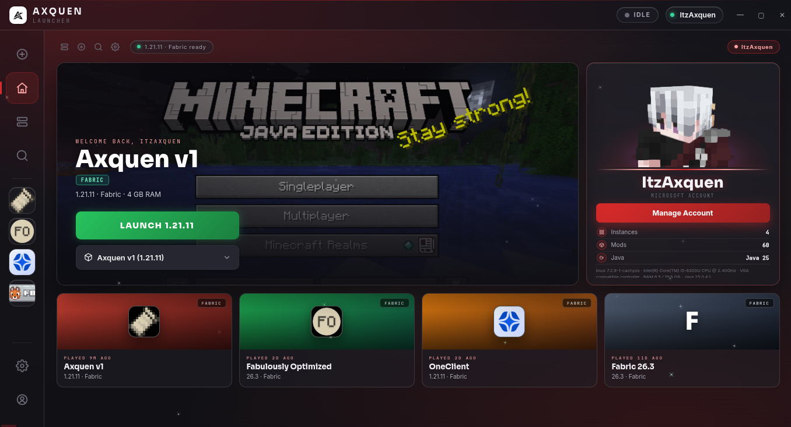
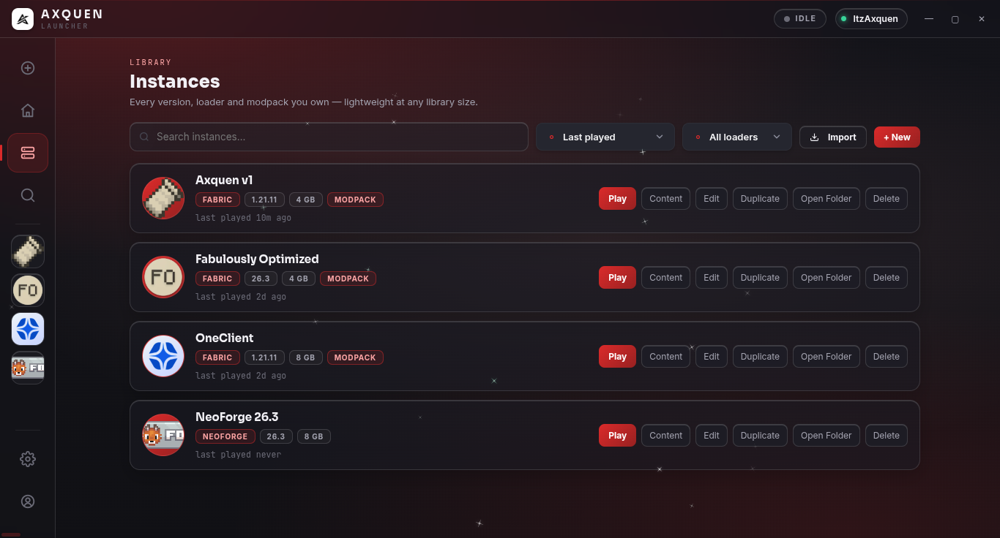
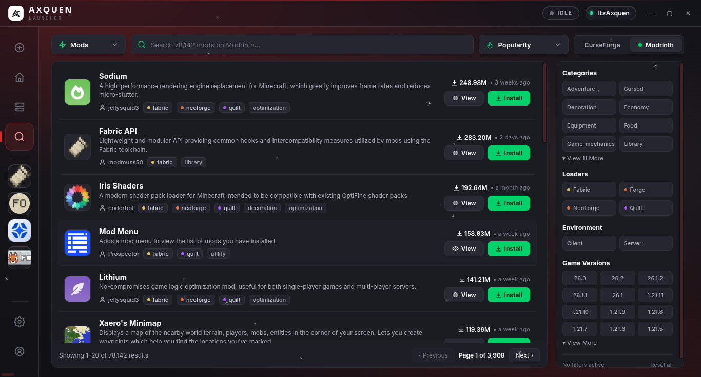
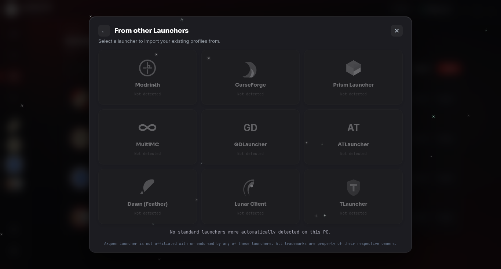

  
  <h1>AXQUEN CLIENT</h1>
  
<strong>Your game. Your setup. Your experience.</strong>

  
A streamlined Minecraft Java Edition launcher and client ecosystem.

  

    
    
    
  

  

    
    
    
    
  

---

## Navigate

[Overview](#overview) · [Screenshots](#screenshots) · [Features](#features) · [Performance](#performance) · [Install](#installation) · [Compatibility](#platforms--compatibility) · [FAQ](FAQ.md) · [Support](SUPPORT.md) · [Legal](#legal)

## Overview

**Axquen Client** is an independent Minecraft Java Edition client and launcher developed by **Regent Playz**. It brings launcher tools, instance management, mod discovery, account options, performance controls, and in-game quality-of-life features into one cohesive experience.

Axquen is designed for players who want a more organized way to manage Minecraft setups, discover compatible mods, personalize their interface, and access useful in-game tools.

> Axquen is proprietary, closed-source software. This public repository contains documentation and community resources; it does not publish the application's source code.

## What makes Axquen different?

- **One library for multiple setups** — keep game versions, loaders, and modpacks separated into instances.
- **Integrated mod discovery** — search and filter a large catalog without leaving the launcher.
- **A configurable experience** — customize themes, HUD elements, and selected in-game tools.
- **Useful diagnostics** — review crash information and use supported recovery options when available.
- **Flexible distribution** — use the Windows launcher or a standalone JAR in a compatible Java environment.

## Screenshots

<table>
  <tr>
    <td width="50%">
      
      
<strong>Home dashboard</strong>

    </td>
    <td width="50%">
      
      
<strong>Instance library</strong>

    </td>
  </tr>
  <tr>
    <td width="50%">
      
      
<strong>Mod browser</strong>

    </td>
    <td width="50%">
      
      
<strong>Launcher import</strong>

    </td>
  </tr>
</table>

## Features

### Performance and Java configuration

Axquen includes a performance-focused Game Mode, a built-in FPS Booster, Java execution settings, and configurable memory allocation. The developer advertises results of **300+ FPS in certain high-graphics configurations** and **up to 1,000+ FPS in lightweight or void environments**. These are advertised examples, not guaranteed benchmarks. Actual performance varies substantially with hardware, drivers, Java, game version, mods, settings, and operating environment.

### Instance management

Create, search, sort, launch, edit, duplicate, and remove separate Minecraft instances. Each setup can retain its own game version, loader, content, and configuration, making it easier to maintain distinct modpacks or play styles.

### Integrated mod browser

Discover mods from the Modrinth and CurseForge source selectors. Search, inspect listings, sort by popularity, and filter by category, loader, environment, and Minecraft version. Available loader filters shown in the interface include Fabric, Forge, NeoForge, and Quilt. Compatibility is determined by each mod's supported versions and dependencies; not every mod works with every setup.

### Import from other launchers

The import interface lists Modrinth, CurseForge, Prism Launcher, MultiMC, GDLauncher, ATLauncher, Dawn (Feather), Lunar Client, and TLauncher. Import availability depends on local installation paths, profile format, and compatibility. Detection or import is not guaranteed for every installation.

### Account management

The launcher provides Microsoft account support and an offline/local account mode where supported, with account switching and profile management. Skin upload, preview, and application are also listed capabilities. Offline mode does not provide Microsoft authentication, Minecraft ownership entitlements, or access to premium-authenticated servers.

### Customization and modular HUD

Personalize the interface with dynamic themes, accent colors, animations, a title-screen switcher, and a custom pause menu. The listed HUD controls include movable and resizable components, ping and armor displays, text colors, background opacity, corner radius, and individual positioning.

### In-game quality of life

- **Friend Protection:** add supported identities, view presence where available, and use the “Can't Hit” option to reduce accidental friendly fire.
- **Distance Waypoints:** save locations and display their positions and distance.
- **Controllable Zoom:** use smooth, adjustable zoom behavior.
- **Loot Beams:** visually distinguish dropped items.
- **Item Overlays:** display supported visual overlays for weapons, tools, held items, and other inventory items.
- **Client presets:** choose from four pre-configured presets. Preset names and exact contents are not specified here.

### Crash diagnostics and recovery

Axquen can detect startup crashes, surface diagnostic information, and identify potentially faulty mods or conflicts. Supported recovery actions may allow suspected mods to be disabled or removed. Not every crash can be diagnosed or repaired automatically. Back up important instances before changing their contents.

## Performance

Performance depends on the CPU, GPU, available RAM, Java runtime, graphics drivers, Minecraft version, installed mods, render distance, graphics settings, and operating environment. Treat FPS figures as developer-advertised examples rather than promises. For troubleshooting steps, see [Troubleshooting](docs/TROUBLESHOOTING.md).

## Installation

### Windows launcher

1. Visit the [official Axquen website](https://client.axquenmc.online).
2. Obtain the current Windows launcher or installer from the official download area.
3. Follow the installer prompts.
4. Open Axquen, configure an account and Java/memory settings as needed, then create or select an instance.

The website is the authoritative download destination. This repository intentionally does not publish an invented direct installer URL.

### Standalone JAR

Standalone `.jar` builds are intended for compatible Minecraft Java instances and third-party Java launchers. Where the target environment supports it, place the JAR in the relevant instance's `mods` folder and follow that environment's normal mod installation procedure.

A JAR is **not** a native Android application. Android use requires a compatible Java runtime and Minecraft Java environment; compatibility is not universal. See [Installation](docs/INSTALLATION.md).

## Platforms & compatibility

| Environment | Documentation status |
|---|---|
| Windows PC launcher | Primary supported distribution |
| Minecraft Java Edition | Primary game target |
| Compatible third-party Java launchers | Standalone JAR may be used where compatible |
| Android/tablet Java environments | Conditional; requires a compatible Java runtime and Minecraft Java environment |

Mod loader and Minecraft version compatibility depend on the specific Axquen build, instance, and mod. Check official release information before updating or changing a setup.

## Documentation

| Guide | Description |
|---|---|
| [Project overview](docs/PROJECT_OVERVIEW.md) | Identity, purpose, audience, and distribution |
| [Feature catalogue](docs/FEATURES.md) | Detailed product capabilities |
| [Installation](docs/INSTALLATION.md) | Windows launcher and standalone JAR |
| [Instance management](docs/INSTANCE_MANAGEMENT.md) | Create, edit, import, and maintain instances |
| [Mod management](docs/MOD_MANAGEMENT.md) | Browse, filter, and install mods |
| [Account management](docs/ACCOUNT_MANAGEMENT.md) | Account modes, profiles, and skins |
| [Troubleshooting](docs/TROUBLESHOOTING.md) | Common diagnostic steps |
| [Privacy](docs/PRIVACY.md) | Data practices requiring developer confirmation |
| [Third-party notices](docs/THIRD_PARTY_NOTICES.md) | Trademarks and external services |
| [FAQ](FAQ.md) | Common questions |
| [Changelog](CHANGELOG.md) | Release history format |

## Community and support

- **Website:** https://client.axquenmc.online
- **Discord and support:** https://discord.gg/StdYxkEXRc
- **GitHub:** https://github.com/RegentPlayz/Axquen-Launcher

Please read [SUPPORT.md](SUPPORT.md) before submitting a report. Bug reports should include relevant versions, reproducible steps, and sanitized logs. Never publish passwords, access tokens, session files, or personal information.

## Contributing

This is a public repository for documentation and community resources. The Axquen application remains proprietary and closed-source. Documentation corrections, bug reports, feature suggestions, and approved community-resource contributions are welcome under the repository owner's review. Read [CONTRIBUTING.md](CONTRIBUTING.md) before opening a pull request.

## Security

Please report suspected vulnerabilities privately through the official [Axquen Discord](https://discord.gg/StdYxkEXRc) rather than posting exploit details publicly. See [SECURITY.md](SECURITY.md).

## Legal

Axquen Client is an independent project and is **not an official Minecraft product**. It is not affiliated with, endorsed by, or sponsored by Mojang Studios or Microsoft. Minecraft and related marks are the property of their respective owners. Modrinth, CurseForge, and the other launcher projects named in this documentation are independent third parties. Their names and trademarks remain theirs; no affiliation or endorsement is implied.

The Axquen application is proprietary software owned by Regent Playz. See [LICENSE](LICENSE) for the project's proprietary terms. Third-party mods, libraries, services, and assets remain subject to their own licenses and terms.

---

  <strong>AXQUEN CLIENT</strong> 
  <em>Your game. Your setup. Your experience.</em>  
  Developed by <strong>Regent Playz</strong> 
  <a href="https://client.axquenmc.online">Official Website</a> ·
  <a href="https://discord.gg/StdYxkEXRc">Discord</a>

